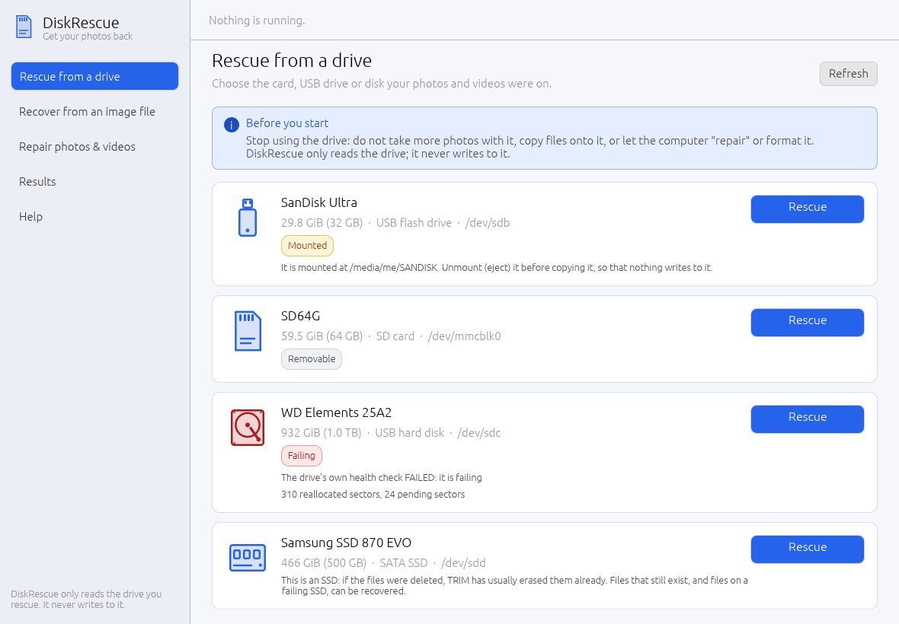
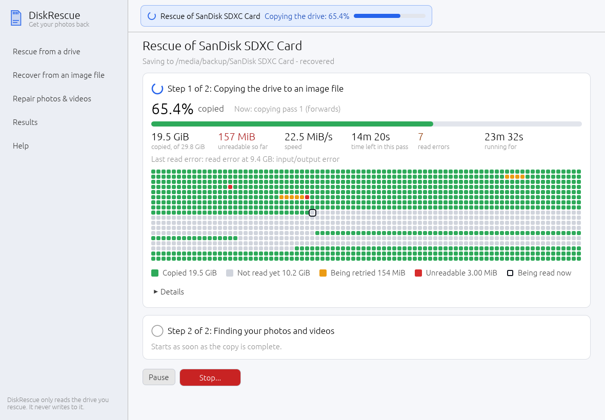
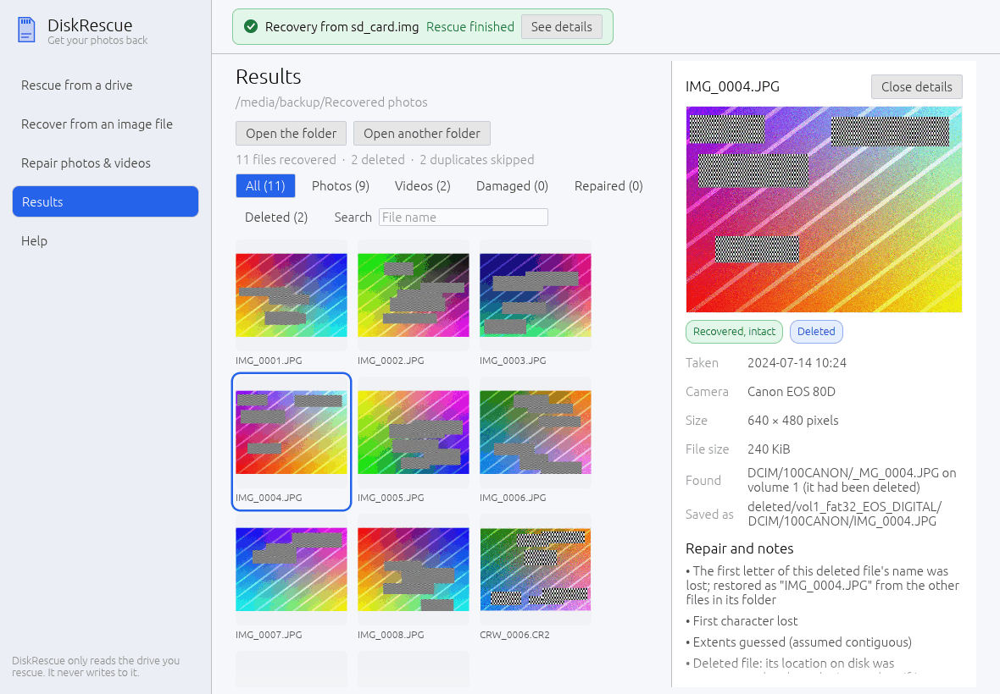

# DiskRescue

[](https://github.com/Dhiva-Labs/DiskRescue/actions/workflows/ci.yml)


**Get your photos and videos back from a dying drive, and repair the files
that came back broken.**

DiskRescue recovers photos and videos from hard disks, SSDs, USB pen drives
and SD cards that are failing, have failed, were reformatted or had files
deleted, and repairs damaged JPEG, PNG, MP4/MOV and AVI files. It comes in
three forms that share one engine:

| Program | For |
|---|---|
| `diskrescue-gui` | the desktop app: pick the drive, press Rescue, browse your photos |
| `diskrescue-tui` | the same flow inside a terminal (servers, rescue USB sticks, SSH) |
| `diskrescue` | the command line, for scripts and experts |







```
diskrescue image /dev/sdb card.img          # careful, resumable copy of a failing device
diskrescue recover card.img -o ~/Recovered  # names, deleted files, carving, repair, report
diskrescue repair broken.mp4 -o fixed --donor good_clip_from_same_phone.mp4
```

## Engineering highlights

- **A re-implementation of GNU ddrescue's algorithm, not a wrapper.** The
  imaging engine follows ddrescue 1.28 (copy, trim, divide, scrape, retry)
  over a read-only `Source` trait, and documents its phases and invariants in
  the module header: data is written before the map marks it finished, the
  output is fsynced before every mapfile save, and a device that vanishes
  never gets sectors marked bad. See
  [`engine.rs`](crates/diskrescue-imaging/src/engine.rs).
- **Fault-injection tests for the engine.** A simulated faulty device
  (bad, slow, flaky areas, timeouts, disappearing devices, short reads) drives
  [`behaviour.rs`](crates/diskrescue-imaging/tests/behaviour.rs), including a
  randomized fuzz (`randomized_fault_fuzz`, seed and iteration count set with
  `FUZZ_SEED` and `FUZZ_ITERS`) that asserts the image never holds wrong data
  for a finished byte, nothing outside the domain is touched, and with all
  phases enabled the bad sectors are exactly the faulty ones. Further
  attacks (flapping devices, absurd sector sizes, failing mapfile saves) are
  in [`review_attacks.rs`](crates/diskrescue-imaging/tests/review_attacks.rs).
- **Mapfile format compatibility.** The mapfile reader and writer
  ([`mapfile.rs`](crates/diskrescue-imaging/src/mapfile.rs)) are tested
  against the examples in ddrescue's format description, including its exact
  column layout, hex/octal/suffixed numbers and older files
  ([`mapfile_compat.rs`](crates/diskrescue-imaging/tests/mapfile_compat.rs)).
  They are not yet checked against the real `ddrescue` binary.
- **Fuzzing the parsers.** 5000 mutated JPEGs go through every public entry
  point of the JPEG crate; no panic may escape and "valid" is never reported
  for data with an error in it
  ([`fuzz.rs`](crates/diskrescue-jpeg/tests/fuzz.rs)). NTFS is tested on real
  `mkntfs` volumes with timing-out and vanishing sources, short reads, damaged
  and torn MFT records and a boot sector that points at the wrong MFT
  ([`media_faults.rs`](crates/diskrescue-ntfs/tests/media_faults.rs)).
- **Many small crates with one direction of dependency.** A Rust workspace of
  19 crates: filesystem parsers (FAT/exFAT, NTFS, ext), a carver, per-format
  repair crates and the CLI, TUI and GUI front-ends. The parser crates never
  depend on each other. See [`docs/ARCHITECTURE.md`](docs/ARCHITECTURE.md).
- **Ground-truth fixtures.** Test images are generated at test time with the
  system's own tools (`mkfs.*`, `mkntfs`, ffmpeg) and checked against fsck,
  ntfs-3g, ffprobe and a BLAKE3 manifest of every file
  ([`diskrescue-fixtures`](crates/diskrescue-fixtures)).

## What it does

**Images failing devices the way a recovery lab would.** The read strategy
follows the device type, detected automatically:

| Device | Strategy |
|---|---|
| Hard disk (internal or USB) | 64 KiB reads, exponential skipping over bad areas so the healthy parts are copied before the drive degrades further, second pass backwards, sector-level scraping last |
| SATA / NVMe SSD | large reads, short timeouts, no trimming (flash fails in whole pages), more retry passes |
| USB pen drive, SD card | small reads, short timeouts, re-opens the device after errors, waits for it to come back when it drops off the bus and recognises it by serial number and first sector, re-checks data after errors because some USB bridges return stale data |

Progress is kept in a mapfile in GNU ddrescue's format: stop at any time and
run the same command again to continue. The format is meant to let ddrescue
continue the same map too, but that has only been tested against ddrescue's
documented examples, not against the ddrescue program. A full-screen
view shows the block map, rates, errors and ETA.

**Recovers by name.** Existing and deleted files, with folders and
timestamps, from FAT12/16/32, exFAT, NTFS and ext2/3/4, under MBR, GPT or no
partition table. It still works when:

- the partition table is gone (lost-partition scan);
- a FAT or exFAT boot sector is destroyed (backup boot sectors, and for FAT
  a rebuild from the two FAT copies: the classic "card needs formatting");
- both NTFS boot sectors are destroyed (the volume is rebuilt from its MFT);
- the deleted name lost its first letter on FAT (restored from the other
  files in the folder, `_MG_0004.JPG` becomes `IMG_0004.JPG`).

**Carves** the free space (or everything, when no filesystem is readable)
for JPEG, HEIC/HEIF, AVIF, PNG, GIF, BMP, WebP, TIFF, camera RAW (CR2, CR3,
NEF, ARW, DNG, ORF, RW2, RAF, PEF, SRW), PSD, MP4/MOV/3GP, AVI, MKV/WebM,
MTS/M2TS/TS, MPG/VOB, MP3, WAV and FLAC. Each file's exact length is measured
by walking its structure, embedded thumbnails and previews are not reported
as separate photos, and copies of files already recovered by name are
skipped.

**Validates and repairs.**

| Problem | Repair |
|---|---|
| Video says "moov atom not found" (camera or phone died while recording) | rebuilds the index from a healthy clip recorded with the same device (H.264 and HEVC with AAC or PCM, B-frames handled) |
| Video stops early | clips the index to the data that is present |
| JPEG cut off, bottom grey | keeps every decodable row and closes the file |
| JPEG header destroyed | transplants the header of a healthy photo from the same camera |
| JPEG without Huffman tables | inserts the standard tables |
| PNG with CRC errors or cut off | fixes checksums, keeps every recoverable row |
| AVI without index | rebuilds the index |

Damaged originals are always kept next to the repaired copies.

**Tells the truth.** `report.txt` and `report.json` list every file, where it
came from, whether it validated, which sectors could not be read (they are
zero-filled, never invented), what was repaired and how.

## Safety

- The source is opened read-only and never written to.
- Output on the device being recovered is refused, including through
  partitions, LVM/RAID layers, loop devices and symbolic links.
- A mounted source is refused unless you pass `--allow-mounted`.
- Devices are read with direct I/O while imaging so cached data cannot hide
  errors.
- Files created while running under `sudo` are given back to your user.

## Install

The latest release is v0.2.1. Version 0.2.2 (Linux on Arm64) is in the
source tree and CI but has not been released yet, and neither have the
packages under "Fedora, openSUSE, Arch and AppImage" below.

**Ubuntu (24.04, x86-64):** from the Dhiva Labs PPA, which currently carries
DiskRescue 0.2.0:

```
sudo add-apt-repository ppa:dhiva-labs/apps
sudo apt install diskrescue
```

**Windows:** DiskRescue is in the [Microsoft Store](https://apps.microsoft.com/detail/9NS2VVPWDM9T) (paid): signed,
updated by the Store, and it adds the `diskrescue` and `diskrescue-tui` commands. The
releases page also has `diskrescue-<tag>-x86_64-windows.zip` (most PCs)
and `diskrescue-<tag>-aarch64-windows.zip` (Windows on ARM) with the
three programs; they are not signed, so SmartScreen or Smart App Control may
warn about them or block them. When a drive needs administrator rights, the
desktop app offers to restart itself with them (a UAC prompt).

**Linux:** download the `.deb` or the tarball from the releases page. v0.2.1
has the x86-64 files; the Arm64 files are built from 0.2.2 on:

| | x86-64 | Arm64 (aarch64) |
|---|---|---|
| Debian / Ubuntu package (24.04 and newer) | `diskrescue_<version>_amd64.deb` | `diskrescue_<version>_arm64.deb` |
| Tarball (static `diskrescue` and `diskrescue-tui`, `diskrescue-gui`) | `diskrescue-<tag>-x86_64-linux.tar.gz` | `diskrescue-<tag>-aarch64-linux.tar.gz` |

`sudo apt install ./diskrescue_<version>_<arch>.deb`. The releases page also
lists `SHA256SUMS` for every download.

**Fedora, openSUSE, Arch and AppImage:** not in a release yet. CI builds
these from the same build as the `.deb`, and the releases page will have them
from the next release on:

| | x86-64 | Arm64 (aarch64) |
|---|---|---|
| Fedora / RHEL / openSUSE | `diskrescue-<version>-1.x86_64.rpm` | `diskrescue-<version>-1.aarch64.rpm` |
| Arch / Manjaro / EndeavourOS | `diskrescue-<version>-1-x86_64.pkg.tar.zst` | `diskrescue-<version>-1-aarch64.pkg.tar.zst` |
| AppImage (the desktop app) | `DiskRescue-<version>-x86_64.AppImage` | `DiskRescue-<version>-aarch64.AppImage` |
| AUR recipe (`diskrescue-bin`) | `diskrescue-bin-<version>-aur.tar.gz` | (same file) |

- Fedora / RHEL: `sudo dnf install ./diskrescue-<version>-1.x86_64.rpm`
- openSUSE: `sudo zypper install --allow-unsigned-rpm ./diskrescue-<version>-1.x86_64.rpm`
  (the `.rpm` is not signed)
- Arch: `sudo pacman -U ./diskrescue-<version>-1-x86_64.pkg.tar.zst`;
  `diskrescue-bin` on the AUR once it is published (until then, `makepkg -si`
  in the unpacked `diskrescue-bin-<version>-aur.tar.gz`)
- AppImage: `chmod +x DiskRescue-<version>-x86_64.AppImage && ./DiskRescue-<version>-x86_64.AppImage`

All of them need glibc 2.39 or newer, like the `.deb` (Fedora 40+, openSUSE
Tumbleweed, current Arch; not RHEL 9 or openSUSE Leap 15). The `.rpm` and the
Arch package install all three programs and recommend pkexec (polkit) and
`xdg-desktop-portal`, as the `.deb` does. CI installs the `.rpm` on Fedora and
openSUSE Tumbleweed, the Arch package on Arch Linux (x86-64; Arch has no
official Arm64 image, so the Arm64 package gets a static check) and the
AppImage on Fedora, and starts all three programs there.

The AppImage holds the desktop app (the command-line and terminal programs
are inside it too, but it starts the desktop app). **Copying a drive that
needs administrator rights does not work from a mounted AppImage:** the
desktop app runs `pkexec` on the `diskrescue` program next to itself, and a
mounted AppImage can only be read by the user who started it, not by root,
so pkexec fails and the app reports that administrator rights could not be
asked for. Start it with `./DiskRescue-<version>-x86_64.AppImage
--appimage-extract-and-run` instead: it unpacks to `/tmp` first, and pkexec
works from there. Recovering from image files and repairing files need no
administrator rights and work either way.

There is no Flatpak: reading a raw device needs root, and inside the sandbox
pkexec cannot gain it and there is no UDisks2 path in DiskRescue to ask for
the device instead.

**From source:**

```
cargo build --release -p diskrescue -p diskrescue-tui -p diskrescue-gui
```

They land in `target/release/`. Keep `diskrescue` next to `diskrescue-gui`:
the desktop app uses it to copy drives with administrator rights.

Reading raw devices needs administrator rights. On Linux the desktop app asks
for them when it needs them (a system password prompt through pkexec); in a terminal
run `sudo diskrescue-tui` or `sudo diskrescue ...`, or add yourself to the
`disk` group. Image files and repairs need no special rights. On Linux,
`packaging/linux/diskrescue.desktop` adds the app to your applications menu.

## Build and test

The toolchain is pinned in `rust-toolchain.toml` (Rust 1.97.1; `rustup`
installs it on first use). The tests build their fixtures with system tools,
so install `dosfstools`, `exfatprogs` (1.2.3 or newer), `ntfs-3g`,
`e2fsprogs`, `ffmpeg` and Python 3 with Pillow first (on Debian/Ubuntu:
`sudo apt install dosfstools exfatprogs ntfs-3g e2fsprogs ffmpeg python3-pil`;
the GUI also needs the GTK/Wayland/xkbcommon development packages listed in
`.github/workflows/ci.yml`). Some tests mount NTFS images as a normal user and
need `ntfs-3g` to be setuid. Tests that need a fixture tool that is missing
may skip rather than fail, so use the same tools as CI.

```
cargo fmt --all -- --check
cargo clippy --workspace --all-targets -- -D warnings
env -u DISPLAY -u WAYLAND_DISPLAY cargo test --workspace --no-fail-fast
FUZZ_ITERS=1000 FUZZ_SEED=1 cargo test -p diskrescue-imaging --test behaviour randomized_fault_fuzz
```

CI runs the first three on x86-64 and Arm64 Linux, and the test suite on
Windows x64 and ARM64 too.

## Documentation

- `docs/USAGE.md`: commands, options and what to do in common situations
  (SD card asks to be formatted, pen drive disconnects, clicking hard disk,
  SSD, deleted photos, video will not play).
- `docs/ARCHITECTURE.md`: how it is built.
- `PRIVACY.md`: DiskRescue works offline and sends nothing anywhere.
- `docs/specs/`: the on-disk formats and algorithms it implements.

## Limits

- Not audited or reviewed by anyone outside the project, and young: the first
  release is from October 2026.
- Tested extensively on synthetic images, simulated failing devices and
  generated media; not yet on real failing hardware or real camera RAW files.
- On Windows, every release is tested end to end on a virtual disk (listing,
  imaging, recovery of existing and deleted files, the desktop app, the
  Microsoft Store package), but not yet on real failing hardware.
- At the last CI run on `main` (2 November 2026), the two Windows jobs
  failed at the step that installs the Microsoft Store package (see issue
  #9); the Linux jobs passed.
- The desktop app has been tested offscreen (every page is driven by
  automated UI tests and rendered headless) but not yet on many real desktops.
- Deleted files on SSDs are usually erased by TRIM within minutes; recovering
  them rarely works. Existing files on a failing SSD can be recovered.
- A device that reports 0 bytes or a few MB has a failed controller; software
  cannot read it, a data recovery lab often can.
- Not supported yet: fragmented-file carving (bifragment gap carving), APFS,
  HFS+, btrfs, XFS, encrypted volumes, NTFS-compressed files in some layouts,
  ext4 journal replay.

## Sponsors

Dhiva Labs is an independent, self-funded lab. [Sponsorships](https://github.com/sponsors/Dhiva-Labs) help bring this project and the rest of Dhiva Labs to every platform, iPhone and Mac included.

[](https://github.com/sponsors/Dhiva-Labs)

Monthly sponsors at $10 and up are listed here:

<!-- sponsors -->
*Be the first: [sponsor Dhiva Labs](https://github.com/sponsors/Dhiva-Labs).*
<!-- sponsors -->

## Licence

MIT. See `LICENSE`.
