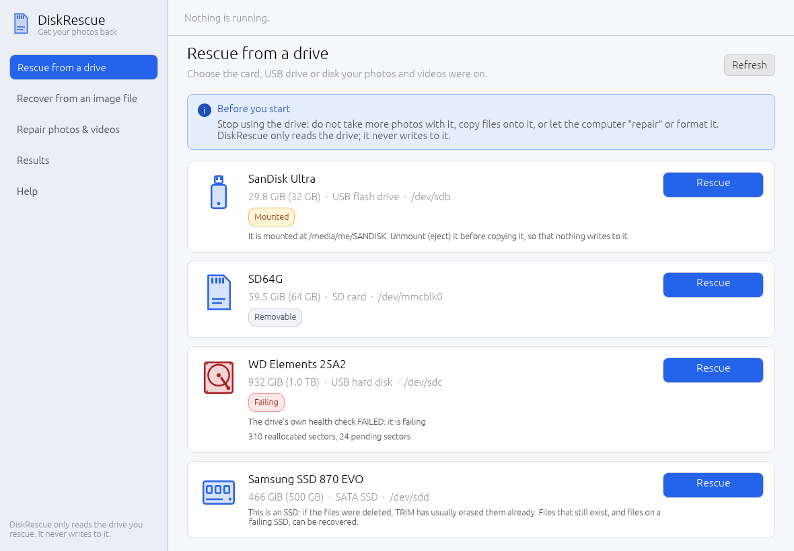
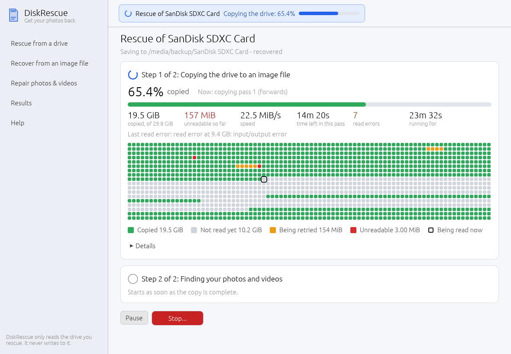
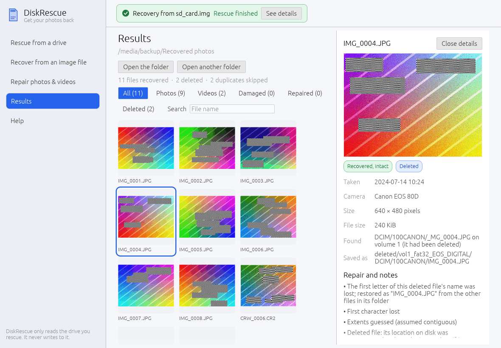

# DiskRescue

**Get your photos and videos back from a dying drive, and repair the files
that came back broken.**

DiskRescue recovers photos and videos from hard disks, SSDs, USB pen drives
and SD cards that are failing, have failed, were reformatted or had files
deleted, and repairs damaged JPEG, PNG, MP4/MOV and AVI files. It comes in
three forms that share one engine:

| Program | For |
|---|---|
| `diskrescue-gui` | the desktop app: pick the drive, press Rescue, browse your photos |
| `diskrescue-tui` | the same flow inside a terminal (servers, rescue USB sticks, SSH) |
| `diskrescue` | the command line, for scripts and experts |







```
diskrescue image /dev/sdb card.img          # careful, resumable copy of a failing device
diskrescue recover card.img -o ~/Recovered  # names, deleted files, carving, repair, report
diskrescue repair broken.mp4 -o fixed --donor good_clip_from_same_phone.mp4
```

## What it does

**Images failing devices the way a recovery lab would.** The read strategy
follows the device type, detected automatically:

| Device | Strategy |
|---|---|
| Hard disk (internal or USB) | 64 KiB reads, exponential skipping over bad areas so the healthy parts are copied before the drive degrades further, second pass backwards, sector-level scraping last |
| SATA / NVMe SSD | large reads, short timeouts, no trimming (flash fails in whole pages), more retry passes |
| USB pen drive, SD card | small reads, short timeouts, re-opens the device after errors, waits for it to come back when it drops off the bus and recognises it by serial number and first sector, re-checks data after errors because some USB bridges return stale data |

Progress is kept in a GNU ddrescue compatible mapfile: stop at any time, run
the same command again to continue, or continue in ddrescue. A full-screen
view shows the block map, rates, errors and ETA.

**Recovers by name.** Existing and deleted files, with folders and
timestamps, from FAT12/16/32, exFAT, NTFS and ext2/3/4, under MBR, GPT or no
partition table. It still works when:

- the partition table is gone (lost-partition scan);
- a FAT or exFAT boot sector is destroyed (backup boot sectors, and for FAT
  a rebuild from the two FAT copies: the classic "card needs formatting");
- both NTFS boot sectors are destroyed (the volume is rebuilt from its MFT);
- the deleted name lost its first letter on FAT (restored from the other
  files in the folder, `_MG_0004.JPG` becomes `IMG_0004.JPG`).

**Carves** the free space (or everything, when no filesystem is readable)
for JPEG, HEIC/HEIF, AVIF, PNG, GIF, BMP, WebP, TIFF, camera RAW (CR2, CR3,
NEF, ARW, DNG, ORF, RW2, RAF, PEF, SRW), PSD, MP4/MOV/3GP, AVI, MKV/WebM,
MTS/M2TS/TS, MPG/VOB, MP3, WAV and FLAC. Each file's exact length is measured
by walking its structure, embedded thumbnails and previews are not reported
as separate photos, and copies of files already recovered by name are
skipped.

**Validates and repairs.**

| Problem | Repair |
|---|---|
| Video says "moov atom not found" (camera or phone died while recording) | rebuilds the index from a healthy clip recorded with the same device (H.264 and HEVC with AAC or PCM, B-frames handled) |
| Video stops early | clips the index to the data that is present |
| JPEG cut off, bottom grey | keeps every decodable row and closes the file |
| JPEG header destroyed | transplants the header of a healthy photo from the same camera |
| JPEG without Huffman tables | inserts the standard tables |
| PNG with CRC errors or cut off | fixes checksums, keeps every recoverable row |
| AVI without index | rebuilds the index |

Damaged originals are always kept next to the repaired copies.

**Tells the truth.** `report.txt` and `report.json` list every file, where it
came from, whether it validated, which sectors could not be read (they are
zero-filled, never invented), what was repaired and how.

## Safety

- The source is opened read-only and never written to.
- Output on the device being recovered is refused, including through
  partitions, LVM/RAID layers, loop devices and symbolic links.
- A mounted source is refused unless you pass `--allow-mounted`.
- Devices are read with direct I/O while imaging so cached data cannot hide
  errors.
- Files created while running under `sudo` are given back to your user.

## Install

**Windows:** DiskRescue is in the Microsoft Store (paid): signed, updated by
the Store, and it adds the `diskrescue` and `diskrescue-tui` commands. The
releases page also has `diskrescue-<version>-x86_64-windows.zip` with the
three programs; they are not signed, so SmartScreen or Smart App Control may
warn about them or block them. When a drive needs administrator rights, the
desktop app offers to restart itself with them (a UAC prompt).

**Linux:** download the `.deb` or the tarball from the releases page.

**From source:**

```
cargo build --release -p diskrescue -p diskrescue-tui -p diskrescue-gui
```

They land in `target/release/`. Keep `diskrescue` next to `diskrescue-gui`:
the desktop app uses it to copy drives with administrator rights.

Reading raw devices needs administrator rights. On Linux the desktop app asks
for them when it needs them (a system password prompt through pkexec); in a terminal
run `sudo diskrescue-tui` or `sudo diskrescue ...`, or add yourself to the
`disk` group. Image files and repairs need no special rights. On Linux,
`packaging/linux/diskrescue.desktop` adds the app to your applications menu.

## Documentation

- `docs/USAGE.md`: commands, options and what to do in common situations
  (SD card asks to be formatted, pen drive disconnects, clicking hard disk,
  SSD, deleted photos, video will not play).
- `docs/ARCHITECTURE.md`: how it is built.
- `PRIVACY.md`: DiskRescue works offline and sends nothing anywhere.
- `docs/specs/`: the on-disk formats and algorithms it implements.

## Limits

- Tested extensively on synthetic images, simulated failing devices and
  generated media; not yet on real failing hardware or real camera RAW files.
- On Windows, every release is tested end to end on a virtual disk (listing,
  imaging, recovery of existing and deleted files, the desktop app, the
  Microsoft Store package), but not yet on real failing hardware.
- The desktop app has been tested offscreen (every page is driven by
  automated UI tests and rendered headless) but not yet on many real desktops.
- Deleted files on SSDs are usually erased by TRIM within minutes; recovering
  them rarely works. Existing files on a failing SSD can be recovered.
- A device that reports 0 bytes or a few MB has a failed controller; software
  cannot read it, a data recovery lab often can.
- Not supported yet: fragmented-file carving (bifragment gap carving), APFS,
  HFS+, btrfs, XFS, encrypted volumes, NTFS-compressed files in some layouts,
  ext4 journal replay.

## Licence

MIT. See `LICENSE`.
